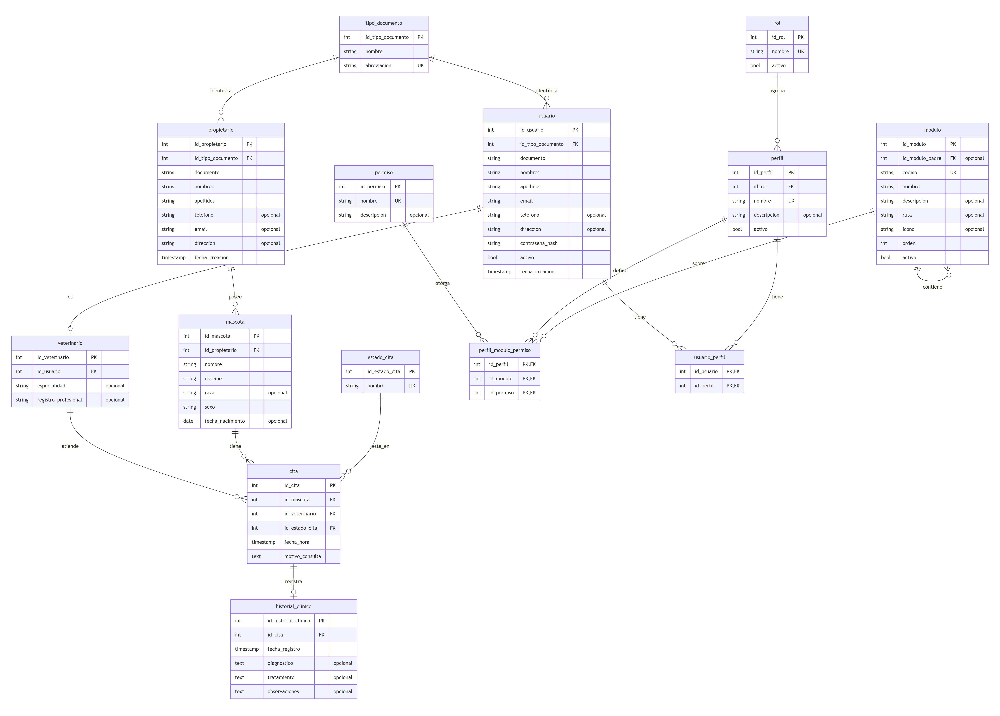
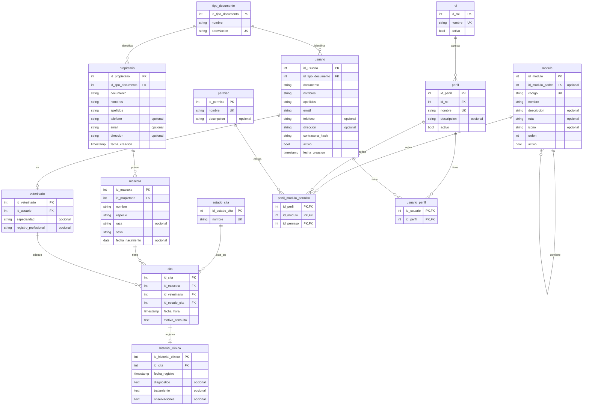

# Modelo entidad–relación de DOG-ATO

Generado a partir de la base de datos creada con `db/DDL.sql` (única fuente del modelo). Imagen lista para el documento:
[`modelo_er.png`](modelo_er.png) · texto editable del diagrama: [`modelo_er.mmd`](modelo_er.mmd) (Mermaid).

## Cómo leerlo
- **PK** llave primaria · **FK** llave foránea · **UK** valor único · «opcional» = admite NULL.
- `||--o{` uno a muchos · `||--|o` uno a uno (como mucho). Todas las llaves primarias son `GENERATED ALWAYS AS IDENTITY`.
- Reglas que el diagrama no muestra y que viven en la BD: correo único sin distinguir mayúsculas, ruta de módulo única, y los triggers
  del menú (2 niveles), de las citas (estados finales, veterinario activo) y del historial (solo lectura, solo de citas completadas).

## Grupos de tablas
| Grupo | Tablas | Para qué |
|---|---|---|
| Catálogos | `tipo_documento`, `estado_cita` | valores repetibles fuera de las tablas de negocio (3FN) |
| Seguridad (gestionada desde la BD) | `rol`, `perfil`, `modulo`, `permiso`, `perfil_modulo_permiso`, `usuario_perfil` | quién entra, qué menú ve y qué puede hacer (CRUD por módulo) |
| Personas | `usuario`, `veterinario`, `propietario` | cuentas del sistema, datos profesionales (1:1 con usuario) y dueños de mascotas (sin cuenta) |
| Operación clínica | `mascota`, `cita`, `historial_clinico` | pacientes, atenciones y su registro (1:1 con la cita) |

## Normalización (3FN)
- **1FN:** campos atómicos (tipo y número de documento, nombres y apellidos separados); sin listas ni grupos repetidos.
- **2FN:** las tablas de llave compuesta (`usuario_perfil`, `perfil_modulo_permiso`) solo contienen la llave: ningún atributo depende de una parte de ella.
- **3FN:** sin dependencias transitivas: el estado de la cita y el tipo de documento son catálogos referenciados; la identidad vive en `usuario` y
  los datos profesionales en `veterinario`; el permiso se asigna a (perfil, módulo, permiso) y no se repite texto.

## Diagrama (Mermaid)

## Cómo volver a generarlo
1. Ejecutar `db/DDL.sql` (o usar la BD `dogato` ya creada).
2. En pgAdmin: clic derecho en la base → **ERD For Database** (diagrama equivalente generado por la propia herramienta), o pegar el bloque
   Mermaid de arriba en https://mermaid.live para exportarlo como imagen.
